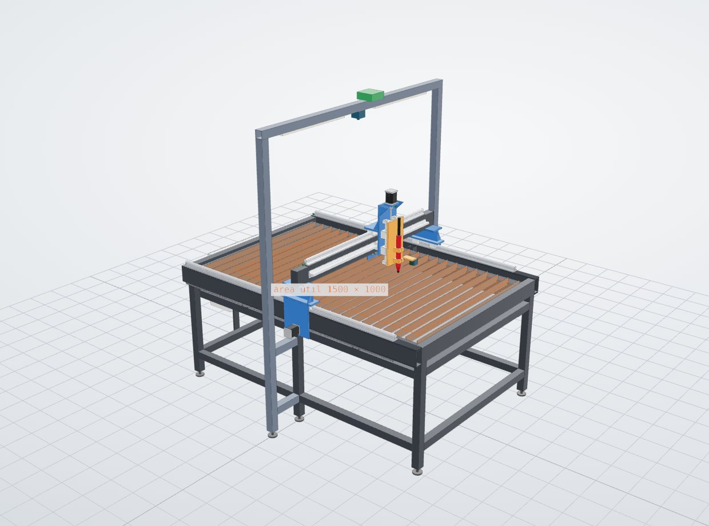
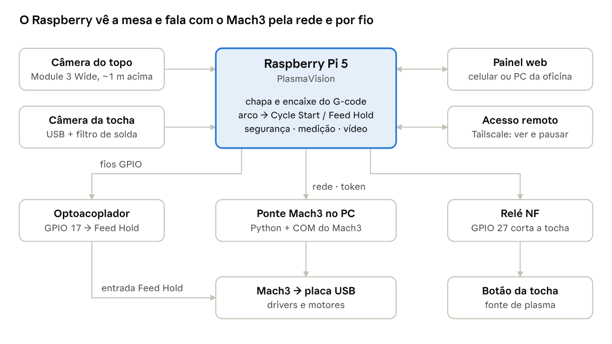
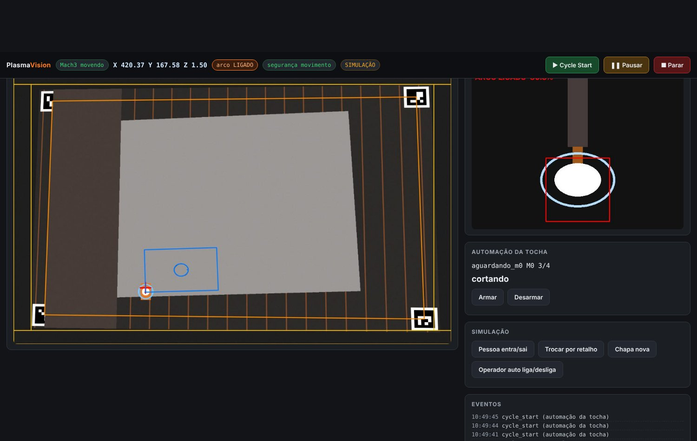

# Mesa CNC Plasma 1500 × 1000 com visão computacional

Projeto completo de uma mesa de corte plasma tipo pórtico, montada com um kit de 4 motores NEMA23 (25 kgf·cm), drivers DM556, placa USB Mach3, guias SBR20 e cremalheira módulo 1 — mais um sistema de visão computacional em Raspberry Pi que alinha a chapa, encaixa o programa, automatiza o Cycle Start pela tocha, vigia a área e mede as peças.



| | |
| --- | --- |
| Área útil | 1500 × 1000 mm (curso 1550 × 1050 × 100) |
| Acionamento | X duplo (X1 + X2 escravo) e Y por cremalheira M1 + pinhão Z20; Z por fuso T8 passo 2 |
| Resolução | 0,0196 mm/passo no X/Y (3200 pulsos/volta) |
| Controle | Mach3 + placa USB 4 eixos 100 kHz |
| Visão | Raspberry Pi 5 + Camera Module 3 Wide (topo) + webcam USB (tocha) |

## O que tem aqui

```
mesa-cnc-plasma/
├── docs/
│   ├── projeto.md            # projeto mecânico e elétrico completo (cálculos, BOM, corte, montagem, Mach3)
│   ├── modelo-3d/            # visualizador 3D interativo (abre no GitHub Pages)
│   └── imagens/
├── cad/
│   ├── modelo_mesa.py        # modelo paramétrico em CadQuery (gera o STEP)
│   ├── pos_processar.py      # gera as malhas do visualizador
│   ├── verificar_interferencias.py
│   └── export/               # STEP da montagem (177 peças), massas
├── visao/                    # PlasmaVision — software do Raspberry Pi
│   ├── plasmavision/         # câmeras, calibração, chapa, encaixe, arco, segurança, medição, painel web
│   ├── tests/                # 18 testes (inclui um ciclo de corte inteiro simulado e a API do painel)
│   ├── scripts/              # instalação no Pi, serviço systemd, exportação do modelo de pessoas
│   └── config.exemplo.yaml
└── mach3_ponte/              # ponte HTTP ↔ COM do Mach3 (roda no PC Windows)
```

## Visão computacional (PlasmaVision)



- **Chapa e retalhos:** compara a vista de cima com a mesa vazia, acha ângulo, canto e formato do material e encaixa o G-code (gira e desloca, inclusive arcos), sem passar por cima do que já foi cortado.
- **Arco → Cycle Start:** com o G-code no padrão M0 “ACENDA / SOLTE”, a câmera da tocha vê o arco abrir, espera a furação e continua o programa; se o arco apagar no meio do corte, dá Feed Hold.
- **Segurança:** pessoa (modelo ONNX) ou movimento na zona desenhada → Feed Hold pela rede **e** por fio, relé corta a tocha, sirene. Trava até alguém reconhecer. *É um auxílio; não substitui emergência nem proteções da NR-12.*
- **Medição:** compara a peça cortada com o DXF ou com o contorno do G-code (±0,5 a 1 mm).
- **Painel web ao vivo**, também pelo celular e de fora da oficina via Tailscale. Remotamente dá para ver, pausar e parar; mandar a máquina andar só pela rede local.



### Testar sem a máquina

```bash
cd visao
pip install -r requirements-dev.txt
python -m pytest              # 18 testes
python -m plasmavision --simular
# abra http://localhost:8080 — câmeras, mesa e Mach3 simulados
```

No modo simulado: aba **Chapa e corte** → Capturar chapa → Peça de teste → Encaixar → Enviar → **Cycle Start** no topo. Um “operador” simulado acende e solta a tocha nas paradas e a automação leva o programa até o fim. O botão *Pessoa entra/sai* testa o alarme.

### Na mesa

1. Raspberry: `visao/scripts/instalar_pi.sh`, depois edite `visao/config.yaml`.
2. PC do Mach3: Python 3 + `pip install pywin32`, rode `mach3_ponte/iniciar_ponte.bat` com o mesmo token.
3. Painel em `http://<ip-do-raspberry>:8080` → Calibração → Segurança → Arco → cortar.

Detalhes em [`visao/README.md`](visao/README.md) e na seção de visão de [`docs/projeto.md`](docs/projeto.md).

## Modelo 3D

- Interativo: [`docs/modelo-3d/`](docs/modelo-3d/). Para publicar: *Settings → Pages → Deploy from branch → main / docs*. Fica em `https://<seu-usuario>.github.io/mesa-cnc-plasma/modelo-3d/`.
- CAD: `cad/export/mesa_cnc_plasma_1500x1000_STEP.zip` abre no SolidWorks, Inventor, Fusion e FreeCAD.
- Para mudar medidas (trilho SBR16, cremalheira M1,5, outro comprimento): edite `cad/modelo_mesa.py` e rode `python cad/modelo_mesa.py saida` (precisa de `pip install cadquery`).

## Premissas a confirmar

O projeto assume eixo apoiado **SBR20 (Ø20)** e cremalheira **módulo 1, 15 × 15 mm** com pinhão de 20 dentes. Se o material for outro, mudam as cotas do CAD e os passos/mm (fórmula em `docs/projeto.md`).

## Licença

MIT — veja [LICENSE](LICENSE). O modelo de detecção de pessoas não vem no repositório; o script de exportação explica a licença do modelo escolhido.
