# Mesa CNC Plasma 1500×1000 — Projeto de Montagem

Breno Dunda Castro · novembro de 2026

## Resumo e premissas

A mesa é um pórtico com **área útil de 1500 × 1000 mm** (curso real 1550 × 1050 mm), com cremalheira e pinhão nos eixos X e Y e fuso no Z. Usa os 4 motores do kit: **X1 e X2** (um de cada lado do pórtico, o X2 como eixo escravo A), **Y** e **Z**. A tocha é ligada manualmente por um botão remoto; a CNC só faz o movimento.

Os 6 m de eixo apoiado foram divididos assim: **2 × 1750 mm no X + 2 × 1200 mm no Y = 5900 mm**, sobrando 100 mm para acerto de corte. Foi isso que definiu a área útil.

Premissas adotadas (o modelo é paramétrico; se alguma estiver diferente do que você comprou, eu refaço as cotas):

| Item | Premissa | Observação |
| --- | --- | --- |
| Eixo linear apoiado | SBR20 (eixo Ø20 mm), 6 m | Se for SBR16, a mesa funciona igual; muda a altura dos blocos |
| Pillow block aberto | SBR20UU, 8 un (4 no X, 4 no Y) | Corre sobre o eixo apoiado |
| Pillow block fechado | SC20UU, 4 un no Z | Precisa de eixo liso (sem apoio) |
| Cremalheira | Módulo 1, 15 × 15 mm, dentes retos | Necessário: 2 × 1750 (X) + 1 × 1200 (Y) = 4,7 m |
| Pinhão | M1, 20 dentes, furo 8 mm, 3 un | Ø primitivo 20 mm = 62,83 mm por volta |
| Eixo Z | Fuso T8 passo 2 mm + 2 eixos Ø20 × 300 + 4 suportes SK20 | Itens a comprar (barato) |
| Chapas | Aço 1020, cortadas a plasma ou laser | Alumínio 6061 também serve e deixa o pórtico mais leve |

Por que o Z vai de fuso e não de cremalheira: o fuso T8 passo 2 é autotravante, então a tocha não cai quando os drivers desligam, e a resolução fica fina para um futuro controle de altura (THC). Os suportes L de motor que você já tem servem no Z (motor em cima do fuso) e podem substituir as placas de motor do X e do Y, desde que tenham rasgo para ajustar o encosto do pinhão.

## Especificações da máquina

A máquina corta chapas de até 1500 × 1000 mm com resolução de 0,02 mm no X/Y e desloca a 10 m/min, com folga grande de força nos motores.

| Parâmetro | Valor |
| --- | --- |
| Área útil de corte | 1500 × 1000 mm |
| Curso X / Y / Z | 1550 / 1050 / 100 mm |
| Dimensões da estrutura (C × L) | 1940 × 1350 mm (1550 mm de largura contando os motores X) |
| Altura total | ≈ 1420 mm (topo do motor Z) |
| Altura da superfície de trabalho (topo das ripas) | 840 mm |
| Transmissão X e Y | Cremalheira M1 + pinhão Z20 direto no motor: 62,83 mm por volta |
| Transmissão Z | Fuso T8 passo 2: 2 mm por volta |
| Micropasso X/Y/A | 3200 pulsos/volta → 50,9296 passos/mm (0,0196 mm por passo) |
| Micropasso Z | 1600 pulsos/volta → 800 passos/mm |
| Deslocamento rápido X/Y | 10 m/min (159 rpm no motor, 8,5 kHz de pulsos) |
| Velocidade Z | 600 mm/min (300 rpm, 8 kHz) |
| Aceleração X/Y / Z | 800 / 400 mm/s² |
| Velocidade de corte | 0,3 a 4 m/min, conforme a tabela da sua fonte de plasma |
| Massa móvel no X (pórtico completo) | 65 kg |
| Massa móvel no Y (carro + eixo Z + tocha) | 20 kg |
| Massa móvel no Z | 7,5 kg |
| Massa da máquina (sem água) | ≈ 315 kg; a bandeja com 80 mm de água soma ≈ 165 kg |
| Alimentação | 127 ou 220 V (chave seletora nas fontes) |

As massas foram calculadas pelo volume de cada peça no modelo 3D (aço 7,85 g/cm³, alumínio 2,7 g/cm³).

## Arquitetura mecânica

O pórtico corre sobre dois trilhos SBR20 no topo das vigas laterais, e todas as cremalheiras ficam por baixo das vigas com os dentes virados para baixo. Assim a borra e a poeira do plasma não assentam nos dentes.

### Estrutura

- Retângulo de tubo 100 × 50 × 3: vigas laterais de 1940 mm e travessas de cabeceira de 1250 mm. Cada viga leva uma barra chata 2″ × 1/4″ soldada em cima, onde o trilho X é parafusado, e outra embaixo, onde vai a cremalheira.
- 6 pés de tubo 50 × 50 × 2 soldados na face **interna** das vigas, com sapata niveladora M16. A face externa e a metade externa da face de baixo ficam livres para cremalheira, motor e placa do motor passarem.
- Travessas inferiores de 50 × 50 a 150 mm do chão, fechando o quadro dos pés.
- Grelha da bandeja em tubo 50 × 50 (2 longarinas + 5 travessas), entre 600 e 700 mm de altura.
- Bandeja d’água em chapa de 2 mm, 1820 × 1140 × 130 mm. Dentro dela, 2 barras chatas 1/8″ × 4″ com rasgos a cada 80 mm seguram 23 ripas de barra chata 1/8″ × 2″ em pé. As ripas ficam soltas: quando gastar, vira ou troca.

### Eixo X (pórtico, 2 motores)

- Em cada lado: placa base de 10 mm sobre 2 blocos SBR20UU com 150 mm entre centros, montante de 10 mm com mão-francesa e uma flange de 10 mm onde a viga do pórtico apoia e é parafusada.
- A placa do motor X (8 mm) desce por fora da viga lateral. O motor fica do lado de fora com o eixo para dentro, e o pinhão engrena na cremalheira presa embaixo da viga.
- A placa tem rasgos verticais de 8 mm: empurre o motor para cima até o pinhão encostar na cremalheira sem folga e aperte os parafusos.
- X1 e X2 têm fim de curso próprio na cabeceira traseira; no home, cada lado para no seu sensor e o pórtico sai esquadrejado.

### Eixo Y (carro)

- Viga do pórtico em tubo 100 × 50 × 3 × 1400 mm, com um trilho SBR20 em cima (sobre barra chata 2″ × 1/4″) e outro direto na face da frente, que tem 100 mm planos. Os dois a 90° seguram o carro contra torção.
- O carro abraça a viga: placa superior de 10 mm sobre 2 blocos, placa frontal de 10 mm sobre 2 blocos e placa traseira de 6 mm com o motor Y.
- A cremalheira Y fica embaixo da viga, dentes para baixo; o motor Y fica atrás da viga com o eixo para a frente.

### Eixo Z (porta-tocha)

- A placa frontal do carro Y é a base do Z e leva os 4 blocos fechados SC20UU.
- Dois eixos Ø20 × 300 correm nesses blocos e ficam presos por 4 suportes SK20 na placa móvel (laranja), que segura a tocha em duas abraçadeiras Ø32.
- Fuso T8 passo 2 no centro: motor em cima com acoplamento 8 × 8, rolamento 608 embaixo, castanha presa na placa móvel. Curso de 100 mm, com a ponta da tocha indo de encostar na chapa até ≈ 95 mm acima dela.
- A tocha no modelo é uma tocha reta Ø32 de máquina. Se for usar a tocha manual da sua fonte, prenda pelo corpo reto perto do bico e passe o cabo por cima, sem esforço lateral.

As imagens do modelo estão no fim do documento; o modelo interativo permite girar, explodir e movimentar os eixos.

## Dimensionamento e cálculos

Os motores de 25 kgf·cm acionando o pinhão direto (sem redução) dão força de sobra: o X precisa de ≈ 29 N por motor para acelerar 65 kg a 0,8 m/s², e cada motor entrega ≈ 100 N. A resolução de 0,02 mm é muito menor que o sangrado do plasma (≈ 1,5 mm).

**1. Passos por milímetro**

```latex
\text{passos/mm} = \frac{\text{pulsos por volta}}{\pi \cdot m \cdot z} = \frac{3200}{\pi \cdot 1 \cdot 20} = 50{,}9296 \qquad \text{Z: } \frac{1600}{2\,\text{mm}} = 800
```

Se o seu pinhão ou módulo for outro, troque m (módulo) e z (nº de dentes): M1,5 com 20 dentes dá 33,9531 passos/mm; M1 com 15 dentes dá 67,9061.

**2. Força disponível no pinhão**

O torque de 2,5 N·m é o de retenção; a 160 rpm e 48 V um NEMA23 desse porte entrega por volta de 1,5 N·m. Para o cálculo foi usado 1,0 N·m (margem para perda de torque e driver limitado a 4,0 A).

```latex
F = \frac{T}{r} = \frac{1{,}0\ \text{N·m}}{0{,}010\ \text{m}} = 100\ \text{N por motor}
```

**3. Aceleração e fator de segurança**

| Eixo | Massa móvel | Força necessária a 0,8 m/s² (com atrito μ = 0,01) | Força disponível | Fator de segurança |
| --- | --- | --- | --- | --- |
| X (2 motores) | 65 kg | 58 N (29 N por motor) | 200 N | 3,4 |
| Y | 20 kg | 18 N | 100 N | 5,5 |
| Z (fuso T8 × 2) | 7,5 kg, vertical | 0,07 N·m no motor | 1,0 N·m | > 10 |

Com fator de segurança acima de 3 o motor de passo não perde passo em uso normal. Se aparecer perda de passo, baixe a aceleração antes de mexer em qualquer outra coisa.

**4. Flecha da viga do pórtico** (tubo 100 × 50 × 3, I = 112 cm⁴, vão 1300 mm)

```latex
\delta = \frac{F L^3}{48 E I} + \frac{5 w L^4}{384 E I} = 0{,}040 + 0{,}028 = 0{,}07\ \text{mm}
```

Carga concentrada F = 196 N (carro Y completo no meio do vão) e peso próprio de viga + trilhos Y + barras chatas w = 0,17 N/mm. A torção da viga pelo balanço da tocha dá menos de 0,02 mm na ponta. As duas são desprezíveis para plasma.

**5. Dente da cremalheira** (Lewis, aço sem tratamento, σ adm. = 100 MPa, b = 15 mm, Y = 0,32): aguenta 480 N contra no máximo 100 N do motor, fator 4,8.

**6. Frequência de pulsos:** 8,5 kHz no X/Y e 8 kHz no Z, contra 100 kHz da placa USB. Sobra margem para subir o micropasso se quiser movimento mais suave.

**7. Corrente e alimentação:** o motor é de 4,4 A e o DM556 vai até 4,0 A RMS (5,6 A de pico); use a maior faixa. Cada fonte de 48 V × 10 A alimenta dois drivers, que puxam de 1,5 a 3 A cada. O DM556 aceita no máximo 50 V e o motor devolve tensão na frenagem, então ajuste o trimpot das fontes para 45 a 46 V.

## Lista de materiais

O kit e as guias que você já comprou cobrem todo o movimento X e Y; falta o conjunto do Z (fuso, eixos lisos e suportes), a estrutura em aço e o material elétrico de instalação. Os códigos (K-, Z-, S-, P-, E-) são os mesmos que aparecem ao clicar nas peças do modelo 3D.

### O que você já tem

| Ref. | Item | Qtd | Onde entra |
| --- | --- | --- | --- |
| K-01 | Motor NEMA23 25 kgf·cm, 4,4 A, eixo 8 mm | 4 | X1, X2, Y, Z |
| K-02 | Driver DM556 | 4 | Um por motor, no quadro |
| K-03 | Fonte chaveada 48 V 10 A | 2 | Fonte 1: X1 + X2; fonte 2: Y + Z |
| K-04 | Placa controladora USB Mach3 4 eixos + cabo + CD | 1 | Quadro |
| K-05 | Eixo linear apoiado SBR20 | 6 m | X: 2 × 1750; Y: 2 × 1200 |
| K-06 | Cremalheira M1 15 × 15 + pinhão M1 Z20 furo 8 | 4,7 m + 3 | X: 2 × 1750; Y: 1 × 1200 |
| K-07 | Pillow block aberto SBR20UU | 8 | 4 no pórtico, 4 no carro Y |
| K-08 | Pillow block fechado SC20UU | 4 | Eixo Z |
| K-09 | Suporte de motor NEMA23 | 4 | Motor Z; os outros como reserva ou no lugar das placas de motor |

### O que falta comprar

| Ref. | Item | Qtd | Observação |
| --- | --- | --- | --- |
| Z-01 | Eixo retificado Ø20 × 300 mm | 2 | Mesmo diâmetro do SC20UU |
| Z-02 | Suporte de eixo SK20 | 4 | Prende os eixos na placa móvel |
| Z-03 | Fuso trapezoidal T8 passo 2 × 300 + castanha com flange | 1 | Passo 2 (não 8): autotravante |
| Z-05 | Acoplamento flexível 8 × 8 mm | 1 | Motor ↔ fuso |
| Z-06 | Rolamento 608ZZ | 1 | Ponta de baixo do fuso |
| S-10 | Sapata niveladora M16 | 6 | Pés |
| — | Porca-rebite M5 de aço | 20 | Reserva para pontos sem barra chata |
| — | Parafusos Allen M5 × 16 (trilhos e cremalheiras) | 120 | Trilho SBR: furos a cada 150 mm em 2 fileiras |
| — | Parafusos Allen M6 × 16 (blocos e SK20) | 56 | 12 blocos × 4 + 4 SK20 × 2 |
| — | Parafusos Allen M5 × 12 (motores) | 16 | 4 por motor |
| E-01 | Quadro metálico 500 × 400 × 200 com placa de montagem | 1 | Com ventilador e filtro |
| E-02 | Cabo blindado 4 × 1,0 mm² (malha) | 25 m | Motores; malha aterrada só no quadro |
| E-03 | Esteira porta-cabos 25 × 38 mm | 3,5 m | 2 m no X, 1,5 m no Y |
| E-04 | Disjuntor bipolar 10 A + chave geral | 1 | Entrada do quadro |
| E-05 | Botão de emergência com 2 contatos NF | 1 | Um contato corta as fontes, o outro avisa a placa |
| E-06 | Trilho DIN, bornes, porta-fusível 5 A (×2) | 1 jogo | Um fusível por fonte |
| E-07 | Fonte 24 V 1 A (ou step-down 48→24 V) | 1 | Só se a placa USB pedir alimentação externa para entradas/saídas |
| E-08 | Sensor de fim de curso (microswitch com rolete ou indutivo NPN) | 5 | X1, X2, Y, Z + 1 reserva |
| E-09 | Isolador USB (ADuM3160) + 4 ferrites de encaixe | 1 | Proteção contra ruído do plasma |
| E-10 | Haste de aterramento + cabo verde 6 mm² | 1 | Terra exclusivo da mesa |
| E-11 | Botão pulsador ou pedal para acionar a tocha | 1 | Ligado em paralelo com o gatilho da tocha |

A estrutura (tubos, barras e chapas) está na lista de corte a seguir.

## Lista de corte

A estrutura sai de 2 barras de tubo 100 × 50 × 3, 4 barras de tubo 50 × 50 × 2, 8 barras chatas e uma chapa #14, mais 14 peças de chapa cortadas a plasma ou laser.

**Por que as barras chatas 2″ × 1/4″ em cima e embaixo dos tubos:** o trilho SBR20 tem duas fileiras de furos a 35 mm uma da outra, e no topo de 50 mm do tubo elas caem no raio do canto. A barra de 6,35 mm dá superfície plana e espessura para rosquear M5 direto (8 fios de rosca). Embaixo, a mesma barra recebe a cremalheira. Solde com pontos alternados de 30 mm a cada 150 mm para não empenar.

### Tubos e barras

| Perfil | Peça | Comprimento (mm) | Qtd | Barras de 6 m |
| --- | --- | --- | --- | --- |
| Tubo 100 × 50 × 3 | Viga lateral | 1940 | 2 | 2 (total 7780 mm) |
| Tubo 100 × 50 × 3 | Travessa de cabeceira | 1250 | 2 |  |
| Tubo 100 × 50 × 3 | Viga do pórtico | 1400 | 1 |  |
| Tubo 50 × 50 × 2 | Pé central | 804 | 2 | 4 (total 19 734 mm) |
| Tubo 50 × 50 × 2 | Pé de canto | 704 | 4 |  |
| Tubo 50 × 50 × 2 | Travessa inferior longitudinal | 895 | 4 |  |
| Tubo 50 × 50 × 2 | Travessa inferior transversal | 1150 | 2 |  |
| Tubo 50 × 50 × 2 | Longarina da bandeja | 1840 | 2 |  |
| Tubo 50 × 50 × 2 | Travessa da bandeja | 1150 | 5 |  |
| Barra chata 2″ × 1/4″ | Assentamento do trilho X / fixação da cremalheira X | 1940 | 4 | 2 (total 11 380 mm) |
| Barra chata 2″ × 1/4″ | Trilho Y / cremalheira Y (na viga do pórtico) | 1200 | 2 |  |
| Barra chata 2″ × 1/4″ | Suporte do quadro elétrico | 610 | 2 |  |
| Barra chata 1/8″ × 2″ | Ripa | 1120 | 23 | 5 |
| Barra chata 1/8″ × 4″ | Suporte das ripas, rasgos 4 × 20 a cada 80 | 1800 | 2 | 1 |
| Chapa #14 (2 mm) | Bandeja: blank 2080 × 1400, dobrar 130 nas 4 bordas e soldar os cantos | — | 1 | chapa 1500 × 3000 |

Os pés já descontam 40 mm da sapata: solde uma chapinha 50 × 50 × 6 com porca M16 no pé de cada tubo.

### Peças de chapa (aço 1020)

| Ref. | Peça | Esp. (mm) | Dimensões (mm) | Qtd | Furação principal |
| --- | --- | --- | --- | --- | --- |
| P-01 | Placa base do pórtico | 10 | 250 × 80 | 2 | 2 blocos SBR20UU com 150 mm entre centros; cada bloco 4 × Ø6,5 em quadrado de 35 |
| P-02 | Placa do motor X | 8 | 200 × 225 | 2 | Rasgo central 39 × 47; 4 rasgos 5,4 × 13,4 no quadrado de 47,14 (ajuste de 8 mm) |
| P-03 | Montante do pórtico | 10 | 200 × 80 | 2 | Soldado entre P-01 e P-04 |
| P-04 | Flange de apoio da viga | 10 | 200 × 100 | 2 | 4 × Ø8,5 para prender a viga com M8 |
| P-05 | Mão-francesa do montante | 6 | triângulo 40 × 75 | 4 | — |
| P-06 | Placa superior do carro Y | 10 | 112 × 180 | 1 | 2 blocos com 100 mm entre centros |
| P-07 | Placa frontal do carro Y / base do Z | 10 | 180 × 337 | 1 | Atrás: 2 SBR20UU; na frente: 4 SC20UU (eixos a ±45 mm do centro), suporte do motor Z e do fuso |
| P-08 | Placa do motor Y | 6 | 120 × 226 | 1 | Mesmo padrão de rasgos da P-02 |
| P-09 | Mão-francesa do carro | 5 | triângulo 40 × 70 | 2 | — |
| P-10 | Suporte inferior do fuso | 8 | 50 × 24 | 1 | Ø22 para o 608ZZ |
| P-11 | Suporte do motor Z (ou suporte L do kit) | 10 | 60 × 80 + 2 mãos-francesas 60 × 60 × 5 | 1 | Ø39 central + 4 × Ø5,5 no quadrado de 47,14 |
| P-12 | Placa móvel Z (porta-tocha) | 10 | 160 × 300 | 1 | 4 SK20 (eixos a ±45 mm) + 2 abraçadeiras |
| P-13 | Suporte da castanha | 8 | 42 × 30 | 1 | Ø10,5 + 4 × Ø3,5 no PCD da castanha |
| P-14 | Abraçadeira da tocha (bloco bipartido) | 25 | 49 × 50 | 2 | Ø32 com rasgo e parafuso M5 de aperto |

Confira as furações dos blocos e dos SK20 nas peças reais antes de cortar: fabricantes diferentes mudam 1 ou 2 mm. O STEP traz todas as chapas em escala para gerar o DXF de corte.

## Montagem passo a passo

A ordem importa: estrutura nivelada → trilho X de referência → trilho X paralelo → cremalheiras → pórtico → Y → Z → motores. O ponto crítico é o paralelismo dos trilhos: se eles abrirem ou fecharem ao longo do curso, os blocos travam.

1. **Barras chatas nas vigas.** Prenda cada viga lateral (e a viga do pórtico) numa bancada plana com grampos e solde as barras 2″ × 1/4″ em cima e embaixo com pontos alternados. Deixe esfriar presa.
2. **Quadro da mesa.** Solde vigas laterais e travessas de cabeceira sobre piso plano. Confira as diagonais: diferença máxima de 1 mm. Depois os pés (pela face interna), as travessas inferiores e a grelha da bandeja.
3. **Nivelamento.** Coloque as sapatas e nivele pelo topo das barras dos trilhos, com nível de precisão (0,1 mm/m), nos dois sentidos e em diagonal.
4. **Furos dos trilhos.** Use o próprio trilho SBR20 como gabarito para marcar os furos na barra. Fure Ø4,2 e rosqueie M5.
5. **Trilho X1 (referência).** Fixe sem apertar, alinhe por um fio de nylon esticado ou régua de alumínio e aperte do centro para as pontas. Meta: retilineidade até 0,1 mm/m.
6. **Trilho X2.** Fixe a 1300 ± 0,2 mm do X1 (centro a centro), medindo em 5 pontos com um gabarito de barra. Altura igual ao X1 com no máximo 0,2 mm de diferença; corrija com calço de lâmina.
7. **Cremalheiras X.** Por baixo das vigas, dentes para baixo, centro a 12,5 mm da face externa da viga, mesma distância do trilho nos dois lados. Se vier em pedaços, engrene um pedaço curto de cremalheira sobre a emenda para manter o passo e só então aperte.
8. **Pórtico.** Monte as placas base nos 4 blocos com parafusos meio frouxos, ponha nos trilhos, monte montantes e flanges e apoie a viga. Esquadreje a viga com os trilhos X por esquadro grande ou pelas diagonais, aperte, e role o pórtico à mão de ponta a ponta: tem de correr sem ponto duro.
9. **Trilhos Y.** Fixe o trilho superior primeiro. Monte o carro com os 4 blocos e só então fixe o trilho frontal, apertando os parafusos enquanto desliza o carro de um lado ao outro.
10. **Cremalheira Y** por baixo da viga, dentes para baixo, centro a 17,5 mm atrás do eixo da viga.
11. **Eixo Z.** Blocos SC20UU na placa frontal, eixos com SK20 na placa móvel, encaixe o conjunto. Instale fuso, rolamento de baixo, acoplamento e motor. Prenda a castanha com folga radial mínima para ela se alinhar sozinha ao fuso.
12. **Motores e pinhões.** Prenda o pinhão pela parte plana do eixo com trava-rosca. Empurre o motor nos rasgos até o pinhão encostar na cremalheira sem folga, gire à mão (sem ponto duro) e aperte. Faça no X1, X2 e Y.
13. **Fins de curso** na cabeceira traseira (X1 e X2), na ponta −Y da viga e no topo do Z.
14. **Bandeja e ripas.** Assente a bandeja, teste com água por 24 h, coloque os suportes e as ripas.
15. **Cabos e esteiras.** Cabo blindado dos motores dentro de esteira, longe do cabo da tocha e do cabo obra.
16. **Lubrificação.** Eixos SBR com óleo leve. Cremalheira e pinhão com lubrificante seco (grafite ou PTFE): graxa comum junta pó do plasma e vira lixa.

## Elétrica

Cada fonte alimenta dois drivers, a placa USB só gera pulsos STEP/DIR, e a emergência tem dois contatos: um corta a energia das fontes e o outro avisa a placa. O acionamento da tocha fica num circuito à parte, sem ligação com a CNC.

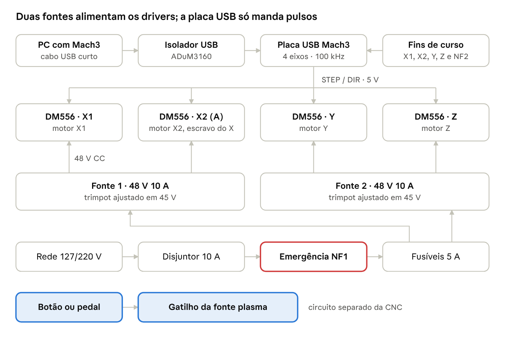

Como o fuso do Z é autotravante, a tocha não cai quando a emergência corta os motores.

### Ligações

| De | Para | Como ligar |
| --- | --- | --- |
| Placa: STEP/DIR do X | DM556 X1: PUL+/PUL−, DIR+/DIR− | Siga o esquema do CD da placa (ânodo comum: 5 V em PUL+ e DIR+). Sinal de 5 V não precisa de resistor |
| Placa: STEP/DIR do A | DM556 X2 | O eixo A vira escravo do X no Mach3 |
| Placa: STEP/DIR do Y e do Z | DM556 Y e DM556 Z | Igual ao X |
| ENA+/ENA− dos drivers | — | Não ligar: o driver fica sempre habilitado |
| DM556 A+ A− B+ B− | Motor (4 fios) | Ache os pares com o multímetro (≈ 0,8 Ω entre os fios do mesmo par). Cabo blindado com a malha aterrada só no quadro |
| Fonte V+/V− | DM556 +V/GND | Cabo 1,5 mm², um par de fios por driver, saindo direto do borne da fonte |
| Fins de curso X1 e X2 | Duas entradas separadas da placa | Separados para o Mach3 esquadrejar o pórtico no home |
| Fins de curso Y e Z | Entradas da placa | Contato NF (abre quando aciona): fio partido vira alarme |
| Emergência NF2 | Entrada E-stop da placa |  |
| Placa USB, alimentação | Fonte 24 V (E-07), se o manual pedir | Muitas dessas placas pedem 12 a 24 V para entradas e saídas |

O motor X2 está espelhado em relação ao X1, então gira ao contrário para andar no mesmo sentido. Inverta a direção do eixo A no Mach3 (ou troque A+ com A− no motor X2). Teste com o pinhão fora da cremalheira.

### Chaves DIP dos drivers

| Driver | Corrente (SW1–SW3) | Corrente em repouso (SW4) | Micropasso (SW5–SW8) |
| --- | --- | --- | --- |
| X1, X2 e Y | Maior faixa: 5,6 A pico / 4,0 A RMS | OFF (meia corrente parado) | 3200 pulsos/volta |
| Z | Maior faixa: 5,6 A pico / 4,0 A RMS | OFF | 1600 pulsos/volta |

A posição ON/OFF de cada chave está na tabela impressa na lateral do driver; ela muda entre fabricantes. Se algum motor passar de 80 °C na carcaça, desça uma faixa de corrente.

## Configuração do Mach3

No Mach3 a máquina é configurada como X, Y, Z com o eixo A escravo do X, em milímetros, com os valores da tabela abaixo. Use sempre o plugin da placa USB que veio no CD: sem ele o Mach3 procura porta paralela e nada se move.

1. Instale o Mach3 e copie o plugin do CD para a pasta `PlugIns` do Mach3. Ao abrir, escolha o plugin da placa USB.
2. **Config → Select Native Units:** milímetros.
3. **Config → Ports and Pins:** habilite X, Y, Z e A. Nas entradas, ligue X Home, A Home, Y Home, Z Home e E-Stop aos pinos onde você conectou os sensores (os nomes dos pinos estão no manual da placa).
4. **Config → Motor Tuning**, eixo por eixo, e clique em *SAVE AXIS SETTINGS* a cada um:

| Eixo | Steps per (passos/mm) | Velocity (mm/min) | Acceleration (mm/s²) | Step pulse / Dir pulse |
| --- | --- | --- | --- | --- |
| X | 50,9296 | 10000 | 800 | 5 µs / 5 µs |
| A (X2) | 50,9296 | 10000 | 800 | 5 µs / 5 µs |
| Y | 50,9296 | 10000 | 800 | 5 µs / 5 µs |
| Z | 800 | 600 | 400 | 5 µs / 5 µs |

5. **Config → Slave Axis:** na linha do X, escolha A (o A passa a copiar todo movimento do X). O A precisa dos mesmos passos, velocidade e aceleração do X.
6. **Config → Homing/Limits:** X, A e Y fazem home no sentido negativo; Z faz home para cima (Home Neg desmarcado no Z). Velocidade de home 20%. Limites por software: X 0 a 1550, Y 0 a 1050, Z −100 a 0.
7. **Esquadro no home:** em *Config → General Config*, desmarque *Home Slave with Master Axis* para que X1 e X2 parem cada um no seu sensor. Alguns plugins de placa USB fazem o home por conta própria e não respeitam essa opção; nesse caso, depois do home confira as diagonais e ajuste a posição de um dos sensores.
8. **Calibração:** mande `G0 X1000`, meça o deslocamento real com trena de aço e corrija: passos novos = passos atuais × 1000 ÷ medido. Repita no Y.

A saída de spindle (M3/M5) fica sem uso por enquanto. Quando quiser automatizar a tocha, um relé nessa saída, em paralelo com o botão da tocha, faz o M3 acender o arco e o M5 apagar.

## Operação com a tocha acionada à mão

O programa para (M0) em cada ponto de furação: você aperta o botão da tocha, espera o arco furar a chapa e dá *Cycle Start*. No fim do contorno ele para de novo para você soltar o botão. Nunca acione a tocha segurando o gatilho no pórtico: use o botão ou pedal remoto (E-11).

**Ligando o botão remoto:** se a sua fonte de plasma tem conector CNC, ligue o botão nele. Sem conector, só ligue em paralelo com o gatilho da tocha se o manual da fonte confirmar que esse circuito é de comando, de baixa tensão e isolado.

1. **Desenho:** faça a peça em CAD e exporte DXF.
2. **CAM:** SheetCAM (pago; a versão de teste limita o tamanho do programa), Fusion (licença pessoal tem corte 2D) ou Inkscape com Gcodetools. Configure:
   - compensação de sangrado (kerf) conforme o bico, em torno de 1,5 mm;
   - entrada e saída (lead-in/lead-out) de 3 a 5 mm, sempre do lado do refugo;
   - altura de furação ≈ 3,8 mm e altura de corte ≈ 1,5 mm (confira no manual da tocha);
   - velocidade de corte da tabela da sua fonte para a espessura e a corrente usadas.
3. **Pós-processador:** use o “Mach3 plasma” e troque o M3 (acender) e o M5 (apagar) por M0 com mensagem. Cada contorno fica assim:

```gcode
G21 G90 G17
G0 Z15
G0 X50 Y50          (ponto de furacao, no refugo)
G0 Z3.8             (altura de furacao)
M0 (ACENDA A TOCHA, ESPERE FURAR E DE CYCLE START)
G1 Z1.5 F300        (altura de corte)
G1 X55 Y50 F1800    (entrada)
(... contorno da peca ...)
M0 (SOLTE A TOCHA E DE CYCLE START)
G0 Z15
```

4. **Zero da peça:** faça o home, leve a tocha ao canto da chapa, zere X e Y. Para o Z, encoste o bico na chapa com uma lâmina de 0,5 mm e zere com *Z = 0,5*. Sem controle de altura, a chapa precisa estar plana: prenda chapas finas com ímãs ou grampos nas ripas.
5. **Ajuste fino:** borra grudada embaixo = velocidade baixa demais; faíscas subindo e corte que não atravessa = rápida demais. Corte uma peça de teste 100 × 100 com furo de Ø30 e meça para acertar o kerf.

## Segurança, aterramento e interferência

O arco de plasma gera muito ruído elétrico, e essa é a causa nº 1 de placa USB desconectando e motor perdendo posição em mesa caseira. Aterramento e cabeamento são parte do projeto, não acabamento.

**Contra interferência**

- Prefira fonte de plasma com abertura de arco por arco-piloto ou contato (“blowback”). Abertura por alta frequência (HF) interfere muito mais.
- Crave uma haste de terra perto da mesa e ligue nela a estrutura (cabo 6 mm²) e a barra PE do quadro.
- Prenda o cabo obra (garra negativa) na estrutura da mesa ou nas ripas, nunca no pórtico.
- Cabos de motor blindados, malha ligada só no lado do quadro, a pelo menos 30 cm do cabo da tocha e em esteira separada.
- Cabo USB curto, com ferrite nas duas pontas e isolador USB. Notebook na bateria durante o corte ajuda.
- Quadro metálico, fechado e aterrado.

**Operação**

- Botão de emergência ao alcance de onde você opera.
- Máscara com lente de tonalidade conforme a corrente (manual da fonte, normalmente 5 a 8), luvas, roupa de algodão e protetor auricular.
- Exaustão ou corte ao ar livre; chapa galvanizada solta fumo de zinco: respirador e exaustão obrigatórios.
- Água na bandeja reduz fumaça e faíscas. Extintor de pó químico perto e nada inflamável embaixo da mesa.
- Não abra o quadro energizado: os bornes de entrada das fontes ficam expostos em 127/220 V.

## Comissionamento

Faça os testes nesta ordem e só acenda o plasma depois que a mesa desenhar o programa com uma caneta sem errar.

- [ ] Mesa nivelada e diagonais do quadro com diferença de até 1 mm
- [ ] Trilhos X a 1300 ± 0,2 mm; pórtico, carro Y e eixo Z correm à mão sem ponto duro
- [ ] Fontes ajustadas em 45 V no multímetro, ainda sem os drivers ligados
- [ ] Chaves DIP conferidas nos 4 drivers
- [ ] Motores girando no sentido certo com os pinhões fora da cremalheira; X1 e X2 levam o pórtico para o mesmo lado
- [ ] Emergência corta as fontes e aparece como E-Stop no Mach3
- [ ] Cada fim de curso acende sua entrada na tela Diagnostics do Mach3
- [ ] Home completo e pórtico esquadrejado: desenhe um retângulo 1000 × 800 com caneta e compare as diagonais (diferença até 0,5 mm)
- [ ] Calibração: 1000 mm comandados = 1000 ± 0,3 mm medidos no X e no Y
- [ ] 10 idas e voltas em G0 de ponta a ponta e retorno ao zero na mesma marca (sem perda de passo)
- [ ] Programa completo desenhado com caneta no lugar da tocha
- [ ] Primeiro corte com aterramento conferido e água na bandeja, observando se a placa USB desconecta quando o arco abre

## Visão computacional

Um Raspberry Pi 5 com duas câmeras acha a chapa e encaixa o programa nela, dá Cycle Start quando vê o arco abrir, pausa a máquina e corta a tocha se alguém entrar na zona marcada e mede as peças cortadas. Tudo aparece num painel web ao vivo, na oficina ou de casa. O software é o **PlasmaVision**, que está no repositório.

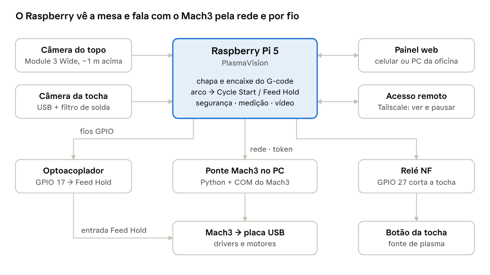

O Raspberry conversa com o Mach3 de dois jeitos: pela rede, com uma ponte em Python no PC que usa a automação COM do Mach3 (o Mach3 publica o objeto `Mach4.Document`, nome histórico — [fórum Machsupport](https://www.machsupport.com/forum/index.php/topic,32199.0.html)), e por fio, numa entrada da placa USB configurada como Feed Hold. O fio pausa a máquina mesmo se a rede ou o Windows travarem.

| Função | Câmera | O que acontece na máquina |
| --- | --- | --- |
| Alinhar chapa e retalhos | Topo | Acha ângulo, canto e formato do material; gira e desloca o G-code para caber, sem passar por cima do que já foi cortado; envia ao Mach3 |
| Arco → Cycle Start | Tocha | No M0 “ACENDA”: vê o arco, espera 0,6 s de furação e dá Cycle Start. No M0 “SOLTE”: vê o arco apagar e segue. Arco apagou no meio do corte: Feed Hold na hora |
| Segurança | Topo | Pessoa (ou movimento) na zona desenhada: Feed Hold pela rede e pelo fio, relé corta a tocha, sirene. Fica travado até você reconhecer |
| Medição | Topo | Compara a peça com o DXF ou com o contorno do G-code: medidas, furos e desvio do contorno, com aprovado/reprovado |
| Painel ao vivo e remoto | As duas | Vídeo com sobreposições, posição, alarmes e comandos. De fora da rede da oficina dá para ver, pausar e parar, mas não para mandar a máquina andar |

A segurança por câmera é um auxílio: não substitui o botão de emergência nem as proteções exigidas pela NR-12.

## Hardware da visão

A câmera do topo fica num pórtico fixo de tubo 50 × 50, na estação dos pés centrais, a 2025 mm do chão (≈ 1035 mm acima da chapa). Dali a lente grande-angular de 120° cobre ≈ 2,5 × 1,4 m, a mesa inteira mais os marcadores, com ≈ 0,55 mm por pixel. Os postes ficam por fora dos motores X (Y = ±850 mm) e a travessa passa 500 mm acima do topo do motor Z; o modelo 3D foi conferido sem interferência nos extremos de curso.

| Ref. | Item | Qtd | Observação |
| --- | --- | --- | --- |
| V-01 | Poste: tubo 50 × 50 × 2 × 1890 + sapata M16 | 2 | Fora dos motores X |
| V-02 | Tirante poste ↔ pé central: tubo 50 × 50 × 2 × 200 | 4 | Dois por lado (150 e 560 mm do chão) |
| V-03 | Travessa da câmera: tubo 50 × 50 × 2 × 1750 | 1 | A 1930 mm |
| V-04 | Raspberry Pi Camera Module 3 Wide + cabo CSI 500 mm | 1 | 12 MP, 120°, foco automático |
| V-05 | Raspberry Pi 5 4 GB + fonte 27 W + cartão 64 GB + caixa IP54 ventilada | 1 | Em cima da travessa. Pi 4 de 4 GB também roda, mais devagar |
| V-06 | Barra de LED 24 V difusa, 600 mm | 2 | Luz constante para a comparação com a mesa vazia |
| V-07 | Braço da câmera da tocha, alumínio 8 mm | 1 | Preso na placa móvel do Z |
| V-08 | Webcam USB 640 × 480, foco fixo | 1 | Olha o bico de lado, a ≈ 50 mm |
| V-09 | Filtro de solda tonalidade 10–11 + vidro de sacrifício | 1 | Sem filtro o arco satura tudo e queima o sensor |
| V-10 | Módulo optoacoplador PC817 + módulo de 2 relés 5 V | 1 | No quadro elétrico |
| — | Cabo USB ativo 5 m | 1 | Câmera da tocha até o Pi, pela esteira |
| — | Cabo de rede Cat6 blindado até o PC do Mach3 | 1 | Wi-Fi funciona, mas cabo aguenta melhor o ruído do plasma |
| — | 4 marcadores ArUco impressos (80 mm) colados em chapinhas 120 × 120 | 4 | Gerados pelo próprio software |

### Ligações do Raspberry

| Pino do Pi | Função | Liga em |
| --- | --- | --- |
| BCM17 (pino 11) | Feed Hold por fio | Optoacoplador → uma entrada livre da placa USB. No Mach3: *Ports and Pins → Input Signals → OEM Trig #1* nesse pino e *System Hotkeys → OEM Trig #1 = 1001* (Feed Hold) |
| BCM27 (pino 13) | Corta a tocha | Relé com contato NF em série com o botão/pedal da tocha: no alarme o contato abre e o arco apaga |
| BCM22 (pino 15) | Alarme | Relé da sirene ou sinaleiro |
| GND (pino 9) | Comum | GND dos módulos |

Os números de botão OEM do Mach3 (1000 Cycle Start, 1001 Feed Hold, 1003 Stop) e os DROs de coordenada de máquina ficam no arquivo `ponte_config.json`; confira na lista de códigos OEM da sua versão do Mach3.

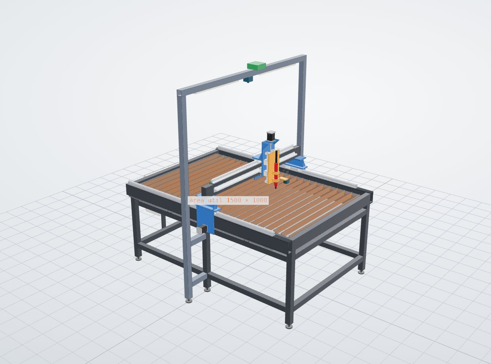

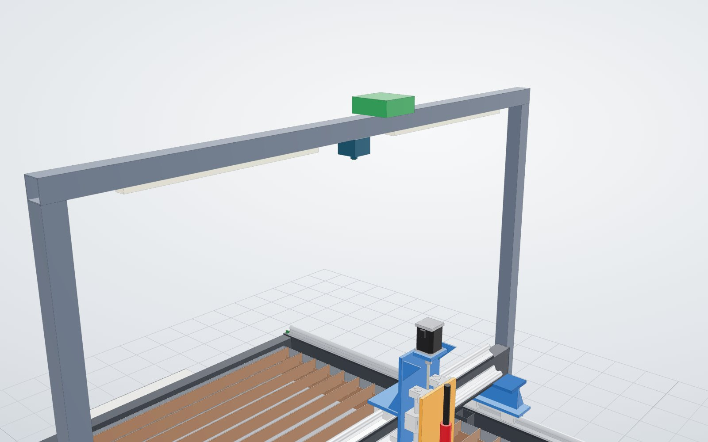

*Pórtico da câmera na estação dos pés centrais: Camera Module 3 Wide sob a travessa, Raspberry Pi 5 (verde) em cima, barras de LED.*

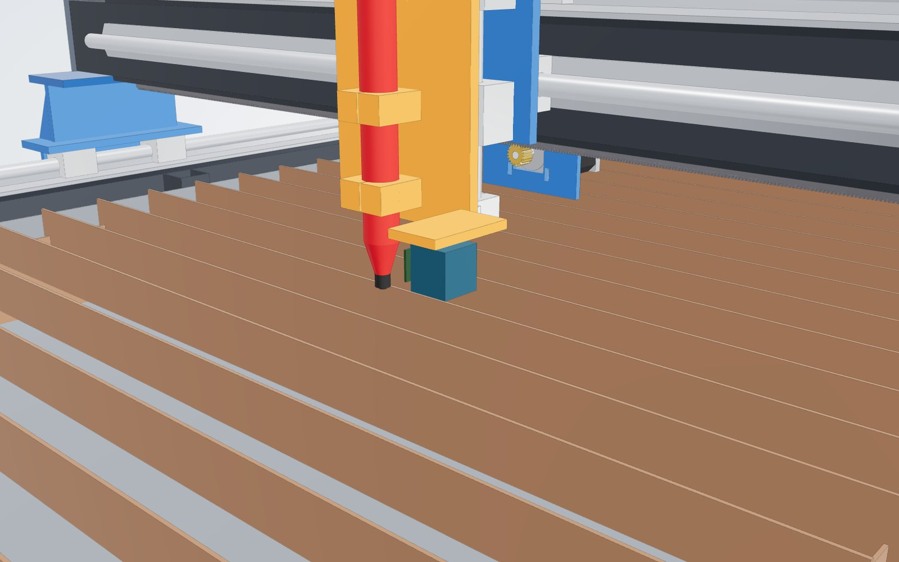

*Câmera da tocha no braço da placa móvel do Z, olhando o bico de lado atrás do filtro de solda.*

## Instalação, calibração e uso da visão

A instalação leva um script no Raspberry e um executável de uma linha no PC do Mach3; depois tudo se faz pelo painel em `http://<ip-do-raspberry>:8080`. Antes de ligar na máquina, rode `python -m plasmavision --simular` em qualquer PC: câmeras, mesa e Mach3 são simulados e dá para treinar o fluxo inteiro.

1. **Raspberry:** grave o Raspberry Pi OS 64 bits, copie a pasta `visao` do repositório e rode `scripts/instalar_pi.sh`. Ele instala tudo, gera os marcadores ArUco para imprimir e deixa o serviço subindo sozinho.
2. **config.yaml:** IP do PC do Mach3, token (uma senha qualquer, igual nos dois lados) e senha do painel.
3. **PC do Mach3:** instale Python 3 e `pip install pywin32`, edite o token em `iniciar_ponte.bat` e coloque-o para abrir com o Windows. O Mach3 precisa estar aberto.
4. **Calibração** (aba Calibração): mesa vazia e pórtico no home → *Capturar mesa vazia*. Ponha os 4 marcadores nos cantos da área útil, leve a tocha ao centro de cada um e clique *usar posição da tocha*. *Calcular calibração*: o erro deve ficar abaixo de 1 mm. Refaça se mexer na câmera.
5. **Segurança:** desenhe as zonas sobre o vídeo (o corredor por onde alguém chega na mesa). Para detectar pessoas, gere o modelo com `scripts/exportar_modelo_pessoa.sh` (veja a licença no script); sem modelo o sistema usa detecção de movimento e ignora a faixa do pórtico.
6. **Arco:** com o arco aceso numa sucata, ajuste o limiar na aba Arco até a barra passar bem do valor de “liga”.
7. **Cortar:** pórtico no home → *Capturar chapa* → envie o G-code → *Encaixar* → confira a prévia → *Enviar* (arma a automação da tocha) → *Cycle Start*. Nas paradas, aperte o botão da tocha e solte quando a máquina parar no fim do contorno: a câmera faz o resto.
8. **Medir:** coloque a peça cortada sobre as ripas, longe da chapa, envie o DXF (ou use o contorno do G-code) e clique *Medir*.

**Acesso remoto:** instale o Tailscale no Raspberry (`curl -fsSL https://tailscale.com/install.sh | sh` e `sudo tailscale up`) e no celular ou no PC de casa, na mesma conta. O painel abre em `http://<nome-do-raspberry>:8080` sem abrir porta no roteador. Fora da rede da oficina você vê tudo e pode **Pausar** e **Parar**; Cycle Start e envio de job só funcionam da rede local, porque ninguém deve mandar a mesa andar sem estar olhando para ela.

**O que foi testado:** 18 testes automáticos e o ciclo completo em simulação (captura da chapa, encaixe, envio, 4 paradas M0 com a automação do arco até “programa concluído”, alarme de segurança). Na máquina real ainda precisam ser validados os códigos OEM da sua versão do Mach3, a entrada Feed Hold da placa USB e os limiares de luz das câmeras.

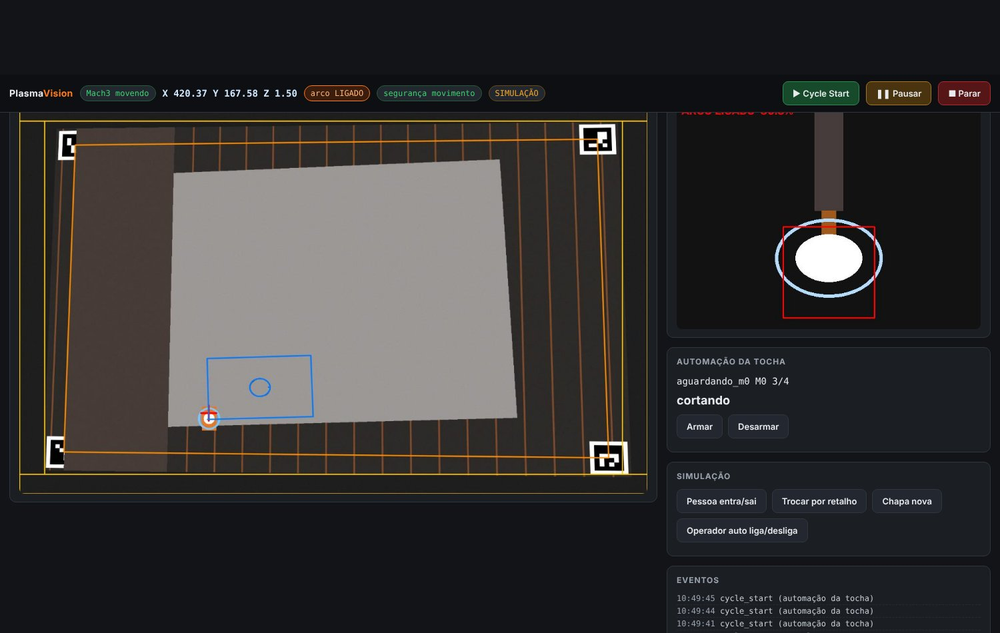

*Painel ao vivo em simulação: câmera do topo com a área de trabalho, o programa encaixado e a tocha; à direita, o arco detectado e a automação no 3º de 4 M0.*

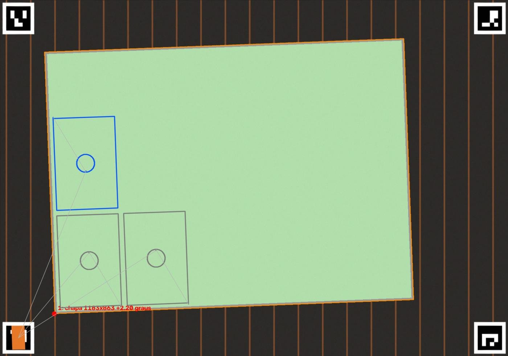

*Encaixe sequencial: a peça nova (azul) entra ao lado das já cortadas (cinza), girada no ângulo da chapa.*

## Repositório no GitHub

O projeto inteiro (este documento em Markdown, CAD, modelo 3D, software de visão e ponte do Mach3) está num repositório git pronto, entregue em `mesa-cnc-plasma.zip`, com histórico de commits e testes automáticos no GitHub Actions.

| Pasta | Conteúdo |
| --- | --- |
| `docs/` | `projeto.md` (este documento), imagens e o modelo 3D interativo em `modelo-3d/` |
| `cad/` | Modelo paramétrico CadQuery, verificação de interferências e STEP da montagem (177 peças) |
| `visao/` | PlasmaVision: código do Raspberry, painel web, 18 testes, scripts de instalação |
| `mach3_ponte/` | Ponte HTTP ↔ COM do Mach3 para o PC Windows |

Para subir:

1. No GitHub, crie um repositório **vazio** chamado `mesa-cnc-plasma` (sem README, sem licença).
2. Descompacte o zip e abra um terminal dentro da pasta `mesa-cnc-plasma`.
3. Rode os dois comandos abaixo, trocando `SEU-USUARIO`:

```bash
git remote add origin https://github.com/SEU-USUARIO/mesa-cnc-plasma.git
git push -u origin main
```

4. Opcional: em *Settings → Pages*, escolha *Deploy from a branch → main → /docs*. O modelo 3D com as câmeras fica em `https://SEU-USUARIO.github.io/mesa-cnc-plasma/modelo-3d/`.

O maior arquivo é o STEP zipado (7 MB), bem abaixo do limite de 100 MB do GitHub, então não precisa de Git LFS.

## Modelo 3D e arquivos

O modelo de montagem tem 177 peças (já com o pórtico da câmera, o Raspberry e a câmera da tocha) nomeadas com os mesmos códigos da lista de materiais e está em dois formatos:

- **Modelo interativo:** [`docs/modelo-3d/`](modelo-3d/) — abre no GitHub Pages. Gira, explode, movimenta X/Y/Z dentro do curso real, simula um corte e mostra nome, código e massa de cada peça clicada.
- **STEP da montagem** ([`cad/export/`](../cad/export/), zipado): abre no SolidWorks, Inventor, Fusion ou FreeCAD. Serve para tirar os DXF das chapas e os desenhos 2D com cota.
- **Script paramétrico** ([`cad/modelo_mesa.py`](../cad/modelo_mesa.py), CadQuery): mudando as premissas no topo do arquivo (diâmetro do trilho, módulo da cremalheira, comprimentos), o modelo inteiro é refeito.

### Vistas do modelo

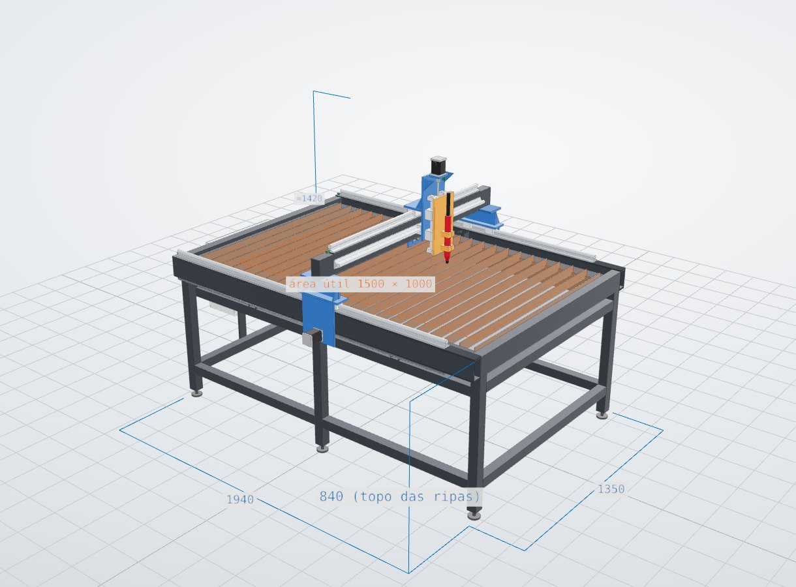

*Montagem completa: estrutura 1940 × 1350, ripas a 840 mm do chão, área útil 1500 × 1000 em laranja.*

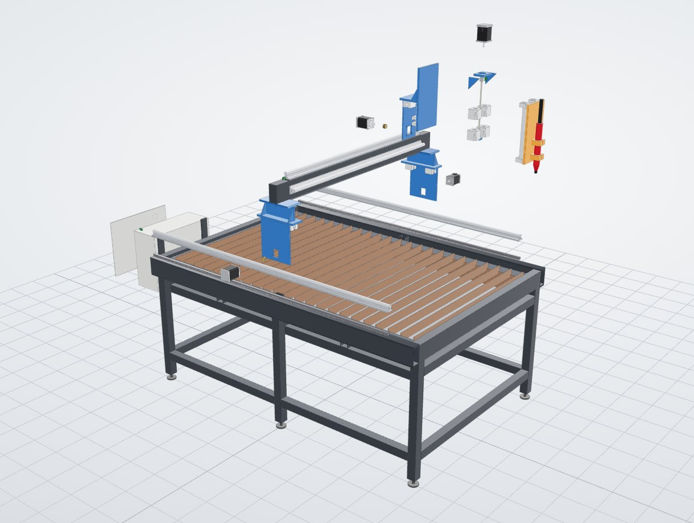

*Vista explodida: estrutura, trilhos e cremalheiras X, pórtico, carro Y, eixo Z fixo e móvel, motores e quadro elétrico.*

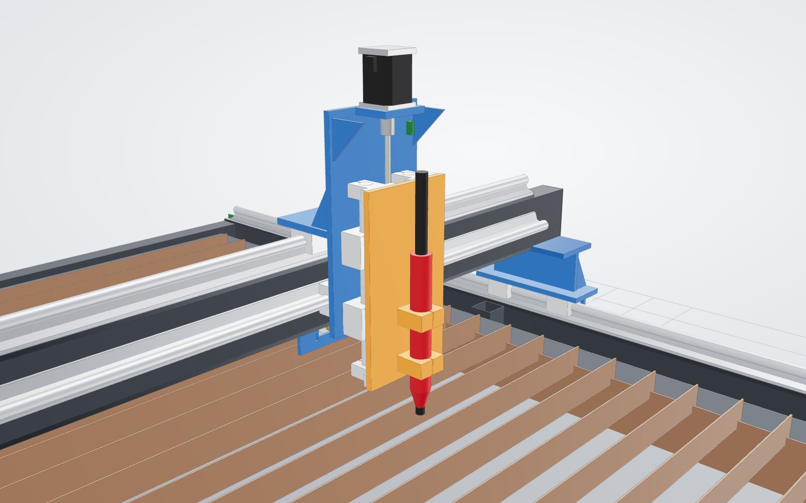

*Eixo Z: 4 blocos SC20UU na placa do carro, placa móvel laranja com 2 eixos Ø20 em SK20, fuso T8 e motor no topo.*

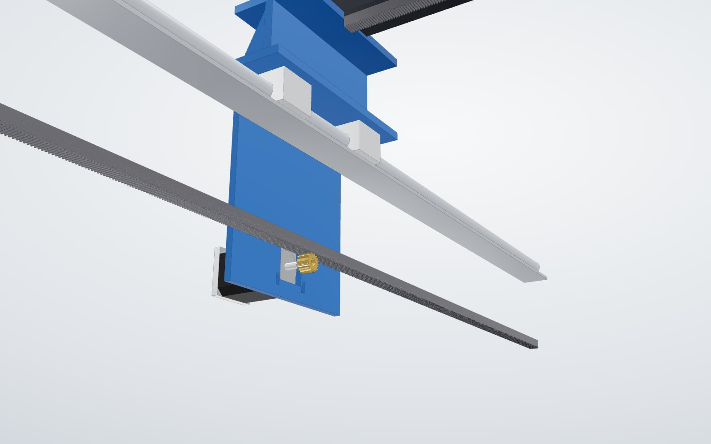

*Acionamento X visto de baixo (estrutura oculta): pinhão Z20 engrenado na cremalheira com dentes para baixo, motor do lado de fora e rasgos de ajuste na placa.*

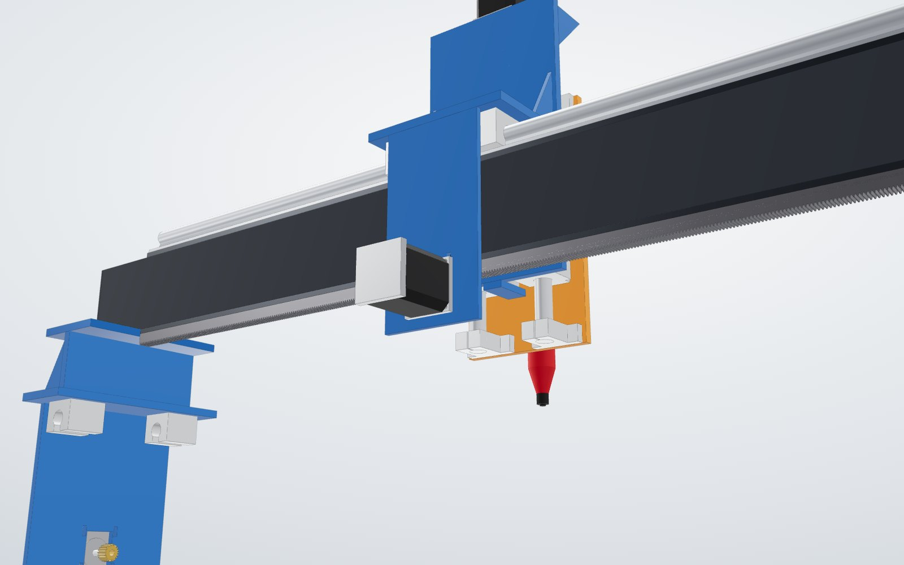

*Acionamento Y visto por trás: motor na placa traseira do carro, cremalheira por baixo da viga.*
